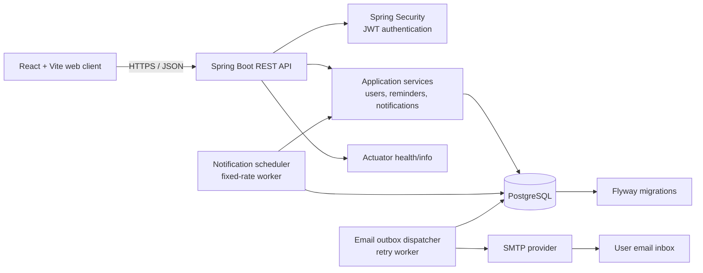
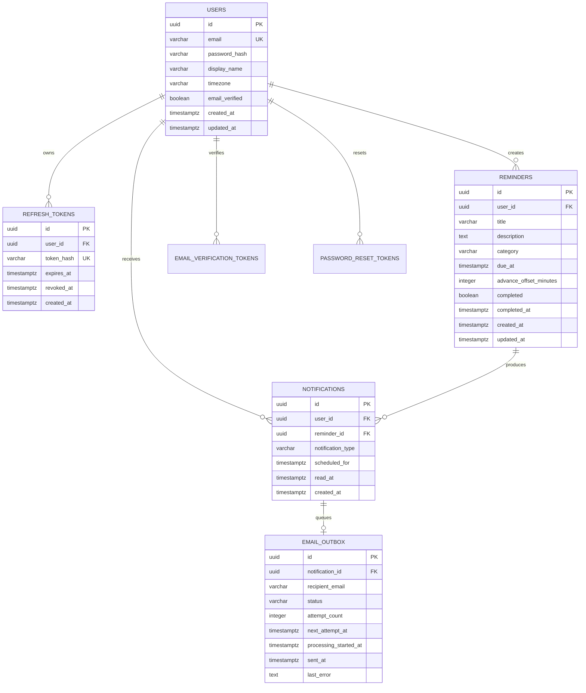

# Remindly

Remindly is a full-stack reminder application for creating, tracking, and receiving notifications for time-based tasks. It provides a React web client, a Spring Boot REST API, PostgreSQL persistence, in-app notifications, and durable email delivery through a transactional outbox.

## Contents

- [Features](#features)
- [Architecture](#architecture)
- [Database design](#database-design)
- [Technology stack](#technology-stack)
- [Repository structure](#repository-structure)
- [Prerequisites](#prerequisites)
- [Configuration](#configuration)
- [Local development](#local-development)
- [API overview](#api-overview)
- [Testing and verification](#testing-and-verification)
- [Deployment](#deployment)
- [Security considerations](#security-considerations)
- [Engineering conventions](#engineering-conventions)

## Features

- Account registration, login, refresh-token rotation, logout, email verification, and password reset.
- JWT-secured API access with short-lived access tokens and persisted refresh tokens.
- Reminder creation, filtering, pagination, editing, completion, and deletion.
- Reminder categories, due dates, descriptions, and optional advance notifications.
- In-app notification inbox with unread counts and mark-read operations.
- Per-user timezone configuration using IANA timezone identifiers.
- Scheduled due and advance notifications with duplicate protection and missed-notification recovery.
- Durable email delivery using a database-backed outbox, retries, exponential backoff, and stale-job recovery.
- Health and readiness endpoints through Spring Boot Actuator.
- Automated backend, frontend, end-to-end, and Docker Compose validation in GitHub Actions.

## Architecture

Remindly follows a layered monolith architecture. The web client communicates with a single Spring Boot API. The API owns authentication, authorization, validation, business rules, persistence, scheduling, and email orchestration. PostgreSQL is the source of truth for application state and durable work queues.



### Request and processing flows

**Authenticated API request**

1. The client sends a bearer access token to the API.
2. `JwtAuthenticationFilter` validates the token and establishes the authenticated user.
3. The controller validates request data and delegates to an application service.
4. The service scopes all reads and writes by the authenticated user ID.
5. JPA persists the transaction in PostgreSQL and the API returns a JSON response.

**Reminder notification flow**

1. `NotificationScheduler` checks reminders that are due or within their configured advance window.
2. It creates an in-app notification and an associated email-outbox row in the same database transaction.
3. Database constraints make notification creation idempotent for each reminder and notification type.
4. `EmailOutboxDispatcher` claims pending jobs, sends email through SMTP, and records success or a retryable failure.
5. Failed jobs are retried with bounded exponential backoff. Jobs stuck in `PROCESSING` can be recovered after the configured stale-processing window.

This design keeps user-visible state and asynchronous email work durable without requiring a separate message broker for the current deployment size.

## Database design

PostgreSQL is the system of record. Hibernate validates the schema at startup, while Flyway owns all schema changes in `backend/src/main/resources/db/migration`.

### Entity relationship diagram



### Table responsibilities and invariants

| Table | Responsibility | Important constraints and indexes |
| --- | --- | --- |
| `users` | Identity, profile, email, and timezone | Case-insensitive unique email; non-blank email/name/timezone |
| `refresh_tokens` | Revocable long-lived session tokens | Stores only token hashes; unique hash; cascade delete by user |
| `reminders` | User-owned reminder state | Completion and `completed_at` must be consistent; indexed by user, due time, status, and category |
| `notifications` | In-app notification records | Type is `ADVANCE` or `DUE`; one notification per reminder/type; indexed for inbox and scheduler queries |
| `email_outbox` | Durable email delivery work | One row per notification; explicit `PENDING`, `PROCESSING`, `SENT`, and `FAILED` states; retry indexes |
| `email_verification_tokens` | One-time email verification credentials | Token hashes only; expiry and used timestamp; cascade delete by user |
| `password_reset_tokens` | One-time password reset credentials | Token hashes only; expiry and used timestamp; cascade delete by user |

### Data design decisions

- UUID primary keys avoid exposing sequential identifiers and work well across future service boundaries.
- Timestamps are stored as `TIMESTAMPTZ`; reminder due times are absolute instants, while each user’s IANA timezone controls presentation and scheduling behavior.
- Foreign keys use `ON DELETE CASCADE` for user-owned data, preventing orphaned sessions, reminders, notifications, and authentication tokens.
- Database checks enforce business invariants close to the data, including valid notification/outbox states and consistent reminder completion fields.
- Token values are hashed before persistence. Raw refresh, verification, and password-reset tokens are not stored in the database.
- Flyway migrations are append-only. Add a new versioned migration for schema changes; do not edit an already-applied migration in a shared environment.

## Technology stack

| Area | Technology |
| --- | --- |
| Frontend | React 19, TypeScript, Vite, React Router, TanStack Query, Axios, Tailwind CSS |
| Backend | Java 21, Spring Boot 3.5, Spring Web, Spring Security, Spring Data JPA, Bean Validation |
| Authentication | JWT access tokens, persisted hashed refresh tokens |
| Database | PostgreSQL 16, Flyway migrations |
| Email | Spring Mail over SMTP with a transactional outbox |
| Testing | JUnit, Spring Security Test, Vitest, Testing Library, Playwright |
| Delivery | Docker Compose for local PostgreSQL; GitHub Actions CI |

## Repository structure

```text
.
├── backend/
│   ├── src/main/java/com/remindly/
│   │   ├── auth/             # Registration, login, JWT, token flows
│   │   ├── email/            # SMTP sender and outbox dispatcher
│   │   ├── notification/     # Notification API and scheduler
│   │   ├── reminder/         # Reminder API and business rules
│   │   ├── user/             # Current-user profile operations
│   │   └── config/           # Security and scheduling configuration
│   ├── src/main/resources/
│   │   ├── application.yml
│   │   └── db/migration/     # Flyway SQL migrations
│   └── pom.xml
├── frontend/
│   ├── src/pages/            # Route-level screens
│   ├── src/components/       # Shared UI components
│   ├── src/api/              # API client, types, and token storage
│   └── package.json
├── .github/workflows/ci.yml  # Continuous integration
├── docker-compose.yml        # Local PostgreSQL service
└── .env.example              # Local configuration template
```

## Prerequisites

- Java 21
- Maven 3.9 or newer
- Node.js 22 or newer
- npm 10 or newer
- PostgreSQL 15 or newer, or Docker Desktop

## Configuration

Copy the root example file and adjust values for the environment:

```powershell
Copy-Item .env.example .env
```

The backend supports `.env` loading for local development and environment variables in deployed environments. The most important settings are:

| Variable | Purpose | Local default |
| --- | --- | --- |
| `DATABASE_URL` | JDBC connection URL | `jdbc:postgresql://localhost:5432/remindly` |
| `DATABASE_USERNAME` / `DATABASE_PASSWORD` | Database credentials | `remindly` / `remindly_dev` |
| `JWT_SECRET` | Access-token signing secret | Development-only fallback; replace it |
| `CORS_ALLOWED_ORIGINS` | Allowed browser origins | `http://localhost:5173` |
| `SMTP_HOST` / `SMTP_PORT` | SMTP server | `localhost` / `25` |
| `SMTP_USERNAME` / `SMTP_PASSWORD` | SMTP credentials | Empty locally |
| `SMTP_AUTH` / `SMTP_STARTTLS` | SMTP security switches | `false` / `false` |
| `EMAIL_FROM` / `EMAIL_FROM_NAME` | Sender identity | `remindly@example.com` / `Remindly` |
| `EMAIL_APP_URL` | Link target used in email templates | `http://localhost:5173` |
| `NOTIFICATION_SCHEDULER_FIXED_RATE_MS` | Notification polling interval | `60000` |
| `NOTIFICATION_RECOVERY_WINDOW_HOURS` | Missed-notification recovery window | `24` |
| `EMAIL_OUTBOX_*` | Outbox polling, batching, retries, and stale-job recovery | See `.env.example` |

Never commit production secrets. Use a secret manager or the deployment platform’s encrypted environment configuration.

## Local development

### 1. Start PostgreSQL

```powershell
docker compose up -d postgres
```

The container exposes PostgreSQL on `localhost:5432` and persists data in the `remindly-postgres-data` Docker volume.

### 2. Start the backend

```powershell
cd backend
mvn spring-boot:run
```

The API starts at `http://localhost:8080`. Flyway applies pending migrations automatically. Health status is available at `http://localhost:8080/actuator/health`.

### 3. Start the frontend

In a second terminal:

```powershell
cd frontend
npm install
npm run dev
```

Vite normally serves the web client at `http://localhost:5173`. The client uses `VITE_API_BASE_URL=/api` by default; configure this variable when the API is hosted elsewhere.

## API overview

All endpoints below are prefixed with `http://localhost:8080`. Protected endpoints require `Authorization: Bearer <access-token>`.

### Authentication

| Method | Endpoint | Purpose |
| --- | --- | --- |
| `POST` | `/api/auth/register` | Create an account |
| `POST` | `/api/auth/login` | Authenticate and receive tokens |
| `POST` | `/api/auth/refresh` | Exchange a refresh token |
| `POST` | `/api/auth/logout` | Revoke a refresh token |
| `POST` | `/api/auth/verify-email` | Verify an email token |
| `POST` | `/api/auth/request-password-reset` | Request a password reset |
| `POST` | `/api/auth/reset-password` | Set a new password |

### Users

| Method | Endpoint | Purpose |
| --- | --- | --- |
| `GET` | `/api/users/me` | Get the authenticated user |
| `PUT` | `/api/users/me/timezone` | Update the user’s timezone |

### Reminders

| Method | Endpoint | Purpose |
| --- | --- | --- |
| `POST` | `/api/reminders` | Create a reminder |
| `GET` | `/api/reminders` | Search, filter, sort, and paginate reminders |
| `GET` | `/api/reminders/{id}` | Get one reminder |
| `PUT` | `/api/reminders/{id}` | Update a reminder |
| `PATCH` | `/api/reminders/{id}/completion` | Complete or reopen a reminder |
| `DELETE` | `/api/reminders/{id}` | Delete a reminder |

The list endpoint supports `completed`, `category`, `dueFrom`, `dueTo`, `page`, `size`, and `sort`, for example:

```text
GET /api/reminders?completed=false&sort=dueAt,asc&page=0&size=20
```

### Notifications

| Method | Endpoint | Purpose |
| --- | --- | --- |
| `GET` | `/api/notifications` | List notifications |
| `GET` | `/api/notifications/unread-count` | Get the unread count |
| `PATCH` | `/api/notifications/{id}/read` | Mark one notification read |
| `PATCH` | `/api/notifications/read-all` | Mark all notifications read |

Paginated endpoints return Spring Data `Page` responses with `content`, `pageable`, `totalElements`, and related pagination metadata.

## Testing and verification

Run the backend tests and package build:

```powershell
cd backend
mvn test
mvn -DskipTests package
```

Run the frontend unit tests and production build:

```powershell
cd frontend
npm ci
npm test
npm run build
```

Run the browser smoke tests after the frontend and backend are available:

```powershell
cd frontend
npx playwright install --with-deps chromium
npm run test:e2e
```

Validate the Compose file without starting services:

```powershell
docker compose config
```

GitHub Actions runs backend tests and packaging, frontend tests and builds, Playwright smoke tests, and Compose validation for pushes and pull requests targeting `main`.

## Deployment

Remindly can be deployed as a stateless Spring Boot API plus a separately hosted React build and managed PostgreSQL instance.

Recommended production sequence:

1. Provision PostgreSQL and restrict network access to the API runtime.
2. Configure `DATABASE_URL`, database credentials, a strong `JWT_SECRET`, CORS origins, SMTP settings, and email settings through the platform secret store.
3. Build the backend with `mvn -DskipTests package` and run the generated Spring Boot artifact.
4. Build the frontend with `npm run build` and serve the generated `frontend/dist` assets from a CDN or web server.
5. Expose `/actuator/health` to the platform health checker, subject to the platform’s access policy.
6. Run at least one API instance with the scheduler and outbox dispatcher enabled. If horizontally scaling, keep the database uniqueness constraints and outbox claiming logic enabled on every instance.
7. Monitor database connectivity, scheduler execution, outbox backlog, failed email attempts, and application health.

Database migrations run on backend startup. In a production pipeline, run migrations as an explicit release step or ensure only one controlled instance performs startup migration at a time.

## Security considerations

- Use a unique, high-entropy `JWT_SECRET` in every non-development environment.
- Use HTTPS for the browser, API, and SMTP connection where supported.
- Keep access-token TTL short and revoke refresh tokens during logout or suspected compromise.
- Store only hashes of refresh, verification, and password-reset tokens.
- Keep CORS restricted to known frontend origins; do not use a wildcard for authenticated production traffic.
- Use a least-privilege database user and encrypted database connections in production.
- Avoid logging passwords, bearer tokens, reset tokens, SMTP credentials, or full email contents containing secrets.
- Configure a real SMTP provider before enabling production email delivery; the local SMTP defaults are development-only.

## Engineering conventions

- Keep business logic in application services rather than controllers.
- Scope every authenticated query and mutation to the current user ID.
- Add schema changes as new Flyway migrations and keep migrations reviewable and reversible where practical.
- Preserve database-level constraints for invariants that must hold regardless of the calling code.
- Add or update unit, integration, and end-to-end tests with behavior changes.
- Use the existing CI workflow as the minimum merge gate.

## License

This project is distributed under the terms in [LICENSE](LICENSE).

